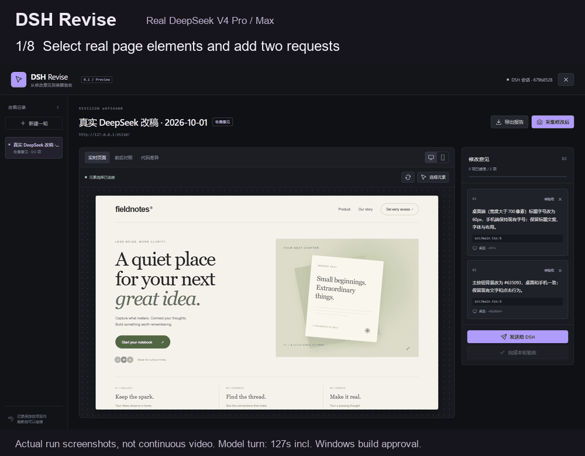
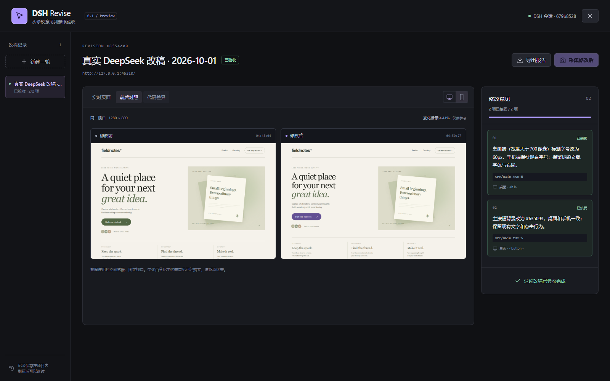

# DSH Revise

**在网页上提出修改意见，用前后截图和代码差异验收 AI 的改动。**

**预览版范围：**仅验证 Windows 上的 **DSH Web 0.2.0-rc.2 + Vite 8.3.1 / React 18.3.1**，使用 Node 24.19.0。界面与报告为**中文**。DeepSeek V4 Pro / Max 跑通一个简单示例；复杂项目、其他框架/模型、Desktop 和其他 DSH 版本均未验证。

[English](README.md) · [下载预览版](https://github.com/Lostforest7/dsh-revise/releases/tag/v0.1.0-pre) · [兼容性与限制](docs/compatibility.md) · [开发说明](CONTRIBUTING.md)



这段 64 秒演示由实际运行截图组成，并非连续录屏。模型轮次实际耗时约 127 秒，其中包含 Windows 构建审批。

DSH Revise 是 [DeepSeek Harness](https://github.com/deepseek-ai/deepseek-harness) 的前端可视化改稿与验收插件。你可以直接指出网页上的元素，把修改要求发送到当前 DSH 会话，再对照实际页面和源码，逐项决定是否接受。



截图来自 2026-10-01 的真实 DeepSeek V4 Pro / Max 改稿。模型根据 JSX 元素提示自行定位并修改 CSS，保留手机标题字号，构建通过。[查看请求、检查、耗时与边界](docs/real-model-validation.md)。

## 能做什么

- **直接选元素提意见**：记录选择器、页面文字、视口坐标及 JSX 源码位置提示。
- **发到当前 DSH 会话**：先预览修改请求，再通过 DSH 的正常消息队列提交。
- **桌面与手机前后对照**：分别采集 1280 × 800、390 × 844 的截图，同时比较采集版本的源码。
- **由你逐项验收**：接受、继续修改、发送补充反馈；重新采集会清空旧版本的接受状态，源码变化后不能用旧截图完成验收。
- **本地保存历史**：每轮记录保存在项目的 `.dsh-revise/` 中，按 DSH 会话隔离。
- **导出完整证据**：下载单个 HTML 文件，内含截图、意见与代码差异；本地也保留 Markdown 和 PNG。

## 安装

建议使用 Node 24，也支持 22.x 中的 22.19 及以上版本。先按 [DSH 官方说明](https://github.com/deepseek-ai/deepseek-harness) 安装并配置 DSH。模型密钥由 DSH 管理，Revise 不需要单独的 API Key。

### 发布包三步开始

从 [v0.1.0-pre 发布页](https://github.com/Lostforest7/dsh-revise/releases/tag/v0.1.0-pre) 下载 `dsh-revise-0.1.0.tgz`。项目尚未发布 npm 包。

1. 用 `dsh plugin --profile web add /发布包的绝对路径/dsh-revise-0.1.0.tgz` 注册插件。设置 `REVISE_CHROMIUM_PATH` 指向已安装的 Chrome，或执行 `npx playwright-core@1.63.0 install chromium` 安装 Chromium。
2. 在前端项目执行 `npm install -D /发布包的绝对路径/dsh-revise-0.1.0.tgz`，按下方配置加入 `revise()`，并把 `.dsh-revise/` 加入 `.gitignore`。
3. 启动前端开发服务器与 `dsh web`，在 DSH 中选择该项目，再点击 **Revise 改稿台**。

发布包包含构建文件，无需安装插件源码仓库的开发依赖。浏览器环境变量需在启动 DSH 前设置。Windows 已安装 Google Chrome 时可使用：

```powershell
$env:REVISE_CHROMIUM_PATH = "C:\Program Files\Google\Chrome\Application\chrome.exe"
dsh web
```

### 从源码安装

开发、体验示例或从源码安装时使用：

```sh
git clone https://github.com/Lostforest7/dsh-revise.git
cd dsh-revise
npm ci
npm run build
npx playwright-core@1.63.0 install chromium
```

停止 DSH，再把插件加入 Web 配置：

```sh
dsh plugin --profile web add /插件目录的绝对路径/dsh-revise
dsh web
```

Windows 示例：

```powershell
dsh plugin --profile web add "C:\Projects\dsh-revise"
dsh web
```

仓库包含构建好的 `lib/`，DSH 加载插件不需要执行包的构建脚本。发布包也可用同一命令安装：把路径换成 `dsh-revise-0.1.0.tgz` 的绝对路径即可。

### 连接 Vite React 项目

在**要修改的前端项目**内安装插件开发依赖：

```sh
npm install -D /插件目录的绝对路径/dsh-revise
```

把以下配置加入 `vite.config.ts`，然后重启 Vite：

```ts
import { defineConfig } from 'vite'
import react from '@vitejs/plugin-react'
import { revise } from 'dsh-revise/vite'

export default defineConfig({
  plugins: [revise(), react()],
  server: { host: '127.0.0.1', port: 5173, strictPort: true },
})
```

元素选择桥与源码属性仅用于开发服务器，Vite 正式构建时不会启用。给前端项目的 `.gitignore` 加一行：

```gitignore
.dsh-revise/
```

### 使用步骤

1. 在 DSH 中打开这个 Vite 项目的会话，并启动项目开发服务器。
2. 点击右下角 **Revise 改稿台**。新建一轮，填写真实的本地开发地址；插件先保存修改前的页面与源码。
3. 点击 **选择元素**，指出页面上的元素，填写并保存具体修改意见。可以切换手机视口、继续添加意见。
4. 点击 **发送给 DSH**，检查请求后确认发送。关闭改稿台，在 DSH 对话中查看改稿进展。
5. DSH 改完且 Vite 热更新结束后，重新打开这轮记录，点击 **采集修改后**，查看前后截图及代码差异。
6. 对每条意见点击 **接受**，或点击 **继续修改** 写反馈，再发送补充意见。全部接受后，点击 **完成本轮验收**。
7. 点击 **导出报告**，下载内嵌截图的 HTML 文件，直接打开即可查看。项目中也保存 `report.html`、`report.md` 和原始截图。

“变化像素”只是图像差异比例，不是质量分数，也不能证明意见已落实。

## 先试示例

在插件源码目录完成 `npm ci`、`npm run build` 后，开两个终端：

```sh
# 终端 1：启动 Vite React 示例，地址 http://127.0.0.1:5173
npm run dev:example

# 终端 2：启动本地改稿台，打开它打印的带令牌地址
npm run dev:workbench
```

这个预览能体验选元素、保存意见、前后采集、人工验收和报告导出。它提供“复制请求”；要直接发送给 DSH，请安装插件，并在 DSH 中把 `examples/vite-react` 作为项目打开。

## 首版的边界

仅接受带明确端口的本地 HTTP 地址，如 `http://127.0.0.1:5173/`。截图使用全新浏览器环境，无登录 Cookie，且只加载同源资源。依赖外部 API、CDN、登录态或禁止 iframe 嵌入的页面，需要适配后使用，截图可能与日常浏览器看到的页面不同。

源码比较覆盖 `src/`、`app/`、`pages/`、`components/` 下支持的文本文件，以及 `index.html`、`package.json`、Vite 和 TypeScript 配置等指定根文件。上限为 500 个文件、单文件 512 KB、合计 5 MB；不比较二进制素材和环境变量文件。源码提示定位 JSX 中的 DOM 元素，不保证直接定位对应的 CSS 规则。

插件负责保存意见与验收证据，代码修改由 DSH agent 完成。当前没有自动回滚、整页截图、多用户协作或云端报告托管。导出的 HTML 包含页面截图与源码差异，分享前请检查内容。

遇到连接、截图或版本问题，请查看 [兼容性与排障说明](docs/compatibility.md)。开发与测试见 [CONTRIBUTING.md](CONTRIBUTING.md)，实际验证记录见 [docs/validation.md](docs/validation.md)。

MIT 开源。社区独立插件，并非 DeepSeek 官方产品。
